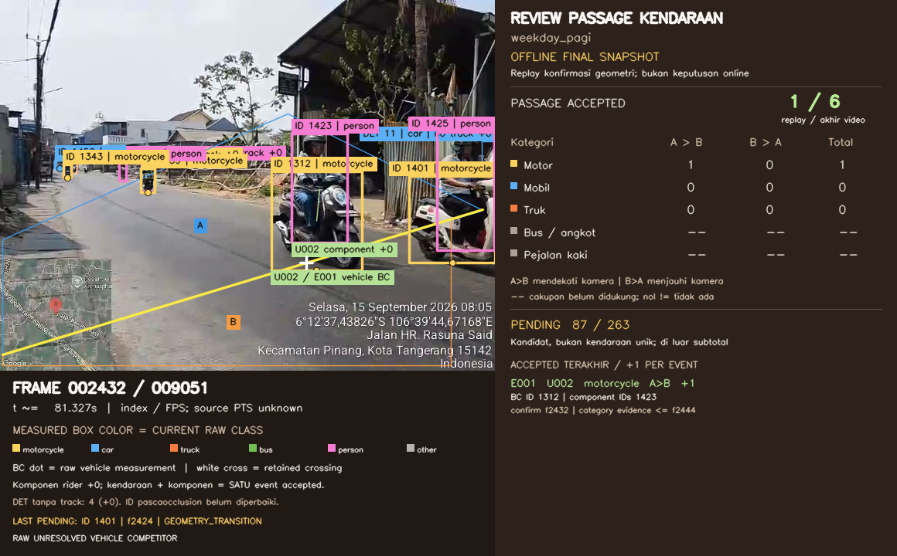

# Phase 8 — anotasi untuk review counting

## Tujuan dan batas perubahan

**REQUIREMENT — permintaan pengguna 15 Oktober 2026:** tambahkan panel pivot kategori × arah, warna kategori pada bbox, label ID/kategori berlatar, nomor frame, serta penjelas hubungan motorcycle–rider. Panel membantu meninjau crossing, deduplikasi dan agregasi pada delapan video TGDI yang sudah dieksekusi.

**USER OBSERVATION:** pengguna melaporkan geometri temporal sudah sesuai dan ID masih dapat berubah setelah oklusi yang lama. Ini umpan balik pengguna, bukan hasil pengukuran robustness atau audit semua passage. Crossing dan agregasi belum dikonfirmasi pengguna karena tampilan sebelumnya belum memadai.

**ENGINEERING DECISION — visualisasi:** renderer membaca sumber video, cache pengukuran, relasi komponen, keputusan dan accepted events asli. Tidak menjalankan detector/tracker/ReID atau mengubah geometri, aturan counting, parameter maupun keputusan mesin. Output baru ditulis terpisah; video anotasi dan snapshot sebelumnya tetap utuh. Implementasi tetap helper/notebook prototype, tanpa UI aplikasi.

## Sumber dan arti angka

Sumber aktual adalah kernel `chrisbiran/phase-8-tgdi-full-video-research` versi 2, run `20261015T083731_664817Z`. Manifest retensi output asli mempunyai SHA-256 `79e8cf19747c63b34f8389d8f525925fd0c69e966f3d12ffb89716a5c89bd0dc`.

**EXPERIMENT RESULT — laporan runtime asli:** delapan pipeline selesai dengan total 72.590 frame, 58 accepted otomatis dan 1.825 kandidat pending. Seluruh accepted berkategori motorcycle. Jumlah pending mengacu kandidat, bukan jumlah kendaraan fisik unik. Nama toko/latitude/longitude masih null; hasil berlabel penelitian. [Baseline tersimpan](evidence/phase_8_annotations/baseline/baseline_retention.json) mengikat byte output asli sebelum perubahan visual.

**ENGINEERING DECISION — timeline offline:** pivot bertambah sekali per accepted event pada frame konfirmasi geometri yang tersimpan. Ini replay **snapshot final offline**, bukan klaim bahwa keputusan akhir sudah tersedia saat crossing. Seluruh 58 event memakai bukti kategori setelah frame konfirmasi. Kartu event mempertahankan rujukan frame konfirmasi dan bukti kategori terakhir agar perbedaan ini terlihat.

Pivot memakai kategori event final dan arah `A_TO_B`/`B_TO_A`. Pending, rejected dan komponen person tidak menambah pivot. Tampilan sampai frame dibedakan dari total accepted akhir video. Kategori unsupported atau taxonomy belum terselesaikan tetap ditandai, tanpa membuat nol palsu. Jumlah bbox, track ID dan episode komponen tidak menjadi jumlah kendaraan/rider.

## Kontrak visual

- Gambar sumber native berada pada area tersendiri; panel ditambahkan di luar gambar. Geometri dan raw bbox memakai koordinat native yang sama.
- Warna bbox mengikuti **kelas mentah pada frame saat ini**. Label berlatar memperlihatkan ID asli dan kelas mentah. Kategori event final ditampilkan terpisah agar perubahan kelas tidak tersembunyi.
- Titik BC tetap berasal dari bbox kendaraan yang benar-benar diukur. Bbox rider dan gabungan bbox tidak menggantikan sumber crossing.
- Garis hubungan person–vehicle hanya tampil pada frame bukti lokal relasi `COMPONENT_OF` yang tersimpan dan didukung untuk event itu, saat kedua observasi emitted terlihat. Tidak mengelompokkan objek berdasarkan kedekatan baru.
- Komponen terasosiasi diberi kontribusi hitung `+0`; unit/passagenya merujuk event sumber. Banyak episode person tidak membuktikan banyak rider.
- Label unit/passage singkat hanya alias tampilan dengan pemetaan ke ID asli. Raw track ID tidak diganti atau disambung melewati gap.
- Nomor frame berbasis nol dan waktu frame/FPS adalah referensi replay; authoritative PTS/audio sumber tidak diklaim dipertahankan.

Perubahan ID setelah oklusi tetap **OPEN**. Renderer membantu melihat dan menelusuri masalah tersebut; ia tidak menyelesaikan asosiasi identitas atau mengubah pending menjadi accepted.

## Cara menjalankan dan mereview

Gunakan [08a_annotation_review.ipynb](../notebooks/08a_annotation_review.ipynb) dengan output kernel Phase 8 versi 2 sebagai input baca-saja dan dataset TGDI asli. Notebook memverifikasi manifest/cache/sumber, menjalankan pengujian visualisasi, lalu merender ulang tanpa model. Lokasi output baru berada di bawah `/kaggle/working/phase_8_annotated_review_v1/`; laporan batch menyebut folder run dan status masing-masing video.

Mulai dari `weekday_pagi`: baseline memiliki enam accepted, tiga A→B dan tiga B→A, serta 263 pending. Periksa unit kendaraan versus komponen, BC, frame konfirmasi dan kenaikan pivot satu kali. Lalu periksa `weekday_siang`, yang memiliki nol accepted dan 223 pending. Nol accepted tidak membuktikan tidak ada kendaraan yang melintas.

Untuk feedback, catat video, frame/timestamp, track/candidate/event ID, keputusan yang dianggap bermasalah, dan bukti visual. Review manual yang mengubah hasil memakai overlay review tersendiri; total tidak diedit langsung. Mesin dan reviewed tetap dua snapshot yang dipilih, bukan dijumlahkan.

Validasi perubahan ini menilai rekonsiliasi angka, provenance, frame alignment, keterbacaan dan retensi output. Belum ada ground truth atau klaim accuracy/precision/recall/F1/MAPE.

## Validasi yang sudah dieksekusi

- [52/52 tes renderer/controller](evidence/phase_8_annotations/verification/annotation_software_tests.json) lulus tanpa skip; source pengujian dan log terikat SHA. Paket Kaggle yang diekstrak juga menjalankan 52 tes yang sama.
- [Preflight delapan input aktual](evidence/phase_8_annotations/verification/all_eight_original_input_preflight.json) memverifikasi 86 artefak yang diperlukan, dengan 58 accepted dan 1.825 pending tetap sama.
- [Render penuh lokal weekday_pagi](evidence/phase_8_annotations/verification/local_full_video_validation.json) menulis lalu mendekode ulang 9.052 frame pada canvas 1160×720. Gambar native 640×480 tetap di posisi/skala asli. Pivot akhir adalah motorcycle 3 A→B dan 3 B→A; pending 263 tetap terpisah. Waktu 129,707 detik adalah waktu render/validasi CPU lokal, bukan benchmark model.
- [Review visual terbatas](evidence/phase_8_annotations/local_review/bounded_visual_review.json) memeriksa contoh frame aktual. Pada frame 2432, ID kendaraan 1312 dan person 1423 memperlihatkan kode unit U002, komponen +0 dan satu event E001. Beberapa label pada objek jauh yang padat masih berimpitan/terpotong; panel dan passage dekat terbaca. Cakupan ini tidak mengesahkan semua identitas/passage.



**EXPERIMENT RESULT — render Kaggle selesai:** [terminal record aktual](evidence/phase_8_annotations/kaggle_submission/execution_terminal_record.json) mengonfirmasi seluruh delapan output selesai, 72.590 frame ditulis dan didekode ulang, dengan 58 accepted/1.825 pending tetap sama. Run anotasi adalah `20261015T150218_945772Z`, kernel [annotation review](https://www.kaggle.com/code/chrisbiran/phase-8-tgdi-annotation-review) versi 1, CPU. Tidak ada eksekusi detector/tracker/ReID/counting baru. Hasil sebelumnya tetap utuh.

## Video yang dapat diakses setelah sesi Kaggle

Delapan MP4 sudah selesai dirender dalam versi tersimpan [Kaggle annotation output](https://www.kaggle.com/code/chrisbiran/phase-8-tgdi-annotation-review/output). Output versi notebook tetap tersedia setelah sesi interaktif berakhir. **Belum ada MP4 yang berhasil diunggah ke GitHub.** Target delivery berikutnya adalah GitHub Releases agar video tidak dimasukkan ke riwayat Git; lihat status autentikasi di bawah.

| Video | Accepted | Pending | MP4 |
|---|---:|---:|---|
| WEEKDAY-PAGI | 6 | 263 | `TGDI-WEEKDAY-PAGI-annotated-review.mp4` — siap lokal, belum diunggah |
| WEEKDAY-SIANG | 0 | 223 | `TGDI-WEEKDAY-SIANG-annotated-review.mp4` — siap lokal, belum diunggah |
| WEEKDAY-SORE | 6 | 323 | `TGDI-WEEKDAY-SORE-annotated-review.mp4` — siap lokal, belum diunggah |
| WEEKDAY-MALAM | 7 | 221 | `TGDI-WEEKDAY-MALAM-annotated-review.mp4` — siap lokal, belum diunggah |
| WEEKEND-PAGI | 5 | 216 | `TGDI-WEEKEND-PAGI-annotated-review.mp4` — siap lokal, belum diunggah |
| WEEKEND-SIANG | 19 | 179 | `TGDI-WEEKEND-SIANG-annotated-review.mp4` — siap lokal, belum diunggah |
| WEEKEND-SORE | 3 | 227 | `TGDI-WEEKEND-SORE-annotated-review.mp4` — siap lokal, belum diunggah |
| WEEKEND-MALAM | 12 | 173 | `TGDI-WEEKEND-MALAM-annotated-review.mp4` — siap lokal, belum diunggah |

Salinan delivery menggunakan H.264/yuv420p dengan `faststart`, pada canvas, jumlah frame dan cadence yang sama. Ini kompresi lossy untuk distribusi; byte/piksel terkompresinya berbeda dari MP4 renderer asli. SHA sumber dan hasil dicatat terpisah pada [delivery manifest](evidence/phase_8_annotations/github_publication/delivery_manifest.json), Publikasi yang berhasil nantinya menghasilkan tanda terima yang mengikat aset aktual ke commit sumber; tanda terima sukses belum ada. Tidak ada frame dipotong atau keputusan counting dihitung ulang. Setelah publikasi berhasil, GitHub dapat menawarkan unduhan MP4 alih-alih pemutaran inline. Saat ini akses persisten tersedia melalui output versi Kaggle tersebut.

Untuk review berikutnya, sebutkan nama video, nomor frame, ID track/unit/event, serta apakah masalahnya salah gabung, duplikasi, kategori atau crossing. Pending tidak masuk pivot accepted. Panel memilih satu snapshot final offline; machine dan reviewed tidak dijumlahkan.

## Publikasi ulang untuk run berikutnya

Helper [prepare_github_videos.py](evidence/phase_8_annotations/verification/prepare_github_videos.py) membuat salinan browser dan bukti codec dari delapan MP4 renderer yang terverifikasi. Lihat `--help` untuk path input dan manifest run. Setelah itu, gunakan [publish_github_release.py](evidence/phase_8_annotations/verification/publish_github_release.py) dari mesin yang mempunyai `gh` terautentikasi. Token disediakan melalui lingkungan/secrets, tidak melalui notebook atau berkas Git.

Pilih **tag baru** dan commit sumber yang sudah di-push untuk setiap publikasi. Jalankan validasi lokal terlebih dahulu:

```bash
python docs/evidence/phase_8_annotations/verification/publish_github_release.py \
  --manifest PATH_TO_DELIVERY_MANIFEST \
  --video-root PATH_TO_BROWSER_MP4_DIRECTORY \
  --repo unChris666/traffic-vehicle-counter-IDM-LOC \
  --tag NEW_RELEASE_TAG \
  --source-commit FULL_PUSHED_SOURCE_COMMIT_SHA \
  --notes-file PATH_TO_RELEASE_NOTES \
  --receipt PATH_TO_PUBLICATION_RECEIPT
```

Tambahkan `--publish` pada perintah yang sama untuk mengunggah. Helper memverifikasi delapan SHA/ukuran, membuat draft, mengunggah video beserta manifest/checksum, memeriksa ukuran dan digest server jika tersedia, lalu menerbitkan release dan menyimpan receipt. Tanpa `--publish`, tidak ada penulisan ke GitHub. Release/tag yang sudah ada ditolak agar tidak tertimpa. Jika upload terputus, draft tetap perlu diperiksa; jangan membuat klaim bahwa publikasi sudah selesai. Langkah ini hanya mengirim hasil yang sudah ada, tanpa menjalankan ulang model/counting.


## Status upload GitHub

**HISTORICAL FAILURE — sebelum revisi7:** repository API, commit dan Git push berhasil, tetapi kedelapan upload aset mengembalikan `401 Bad credentials` dari `uploads.github.com`. [Bukti kegagalan](evidence/phase_8_annotations/github_publication/publication_failure.json) mempertahankan ID draft, nol aset, commit sumber, serta status konfigurasi. Draft kosong yang dibuat percobaan ini dihapus setelah diverifikasi tidak mempunyai aset; tidak ada video hasil pengguna yang dihapus.

**ACTUAL CURRENT CHECK — 16 Oktober 2026:** environment revisi7 mengamati `GH_TOKEN` berstatus **ready** untuk `api.github.com` dan `uploads.github.com`. Uji upload checksum kecil ditolak **HTTP403 — Resource not accessible by personal access token**. Binding environment sudah aktif, tetapi izin upload repository belum berhasil diverifikasi. [Bukti aktual](evidence/phase_8_publication/credential_verification.json) mencatat nol video terunggah dan pembersihan draft uji. Periksa token yang sama di GitHub: **Resource owner unChris666**, akses repository **traffic-vehicle-counter-IDM-LOC**, dan **Contents: Read and write**. Jangan menaruh token dalam chat, notebook atau repository. Status403 ini tidak menetapkan mana dari pengaturan token tersebut yang keliru. [Arsip konteks](evidence/phase_8_publication/baseline/context_retention_mapping.json) mempertahankan bytes status lama.

Setelah otorisasi token diperbaiki dan uji upload berhasil, gunakan helper publikasi di atas dengan `--publish` dan SHA commit sumber terbaru yang sudah di-push. Semua video/manifest telah disiapkan; YOLO/tracker/ReID/counting tidak perlu dijalankan ulang. Jika workspace berganti, unduh kembali output versi Kaggle yang sudah selesai dan verifikasi SHA menggunakan manifest tersimpan sebelum menyiapkan kembali salinan delivery.
