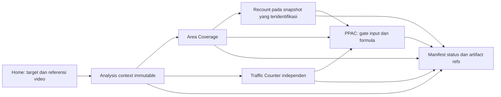

# Location Intelligent — cakupan dan bukti

21 Oktober 2026. **DOCUMENTED; bukan implementasi aplikasi.** Pengguna
mengonfirmasi dokumentasi/integrasi memakai repo Traffic Counter yang sama.
Runtime Traffic, konfigurasi malam dan hasil eksperimen lama tidak diubah.
LI-0/LI-1 menambahkan validator/seleksi bangunan offline; LI-2 menambahkan
routing diagnostics (overall PARTIAL, final accessibility BLOCKED).
Belum full Area Coverage/aplikasi terpadu. Status terbaru22 Oktober2026.

## Register sumber

| ID | Sumber yang diperiksa | Yang dapat dibuktikan / batas |
|---|---|---|
| R1 | Workspace `unChris666/traffic-vehicle-counter-IDM-LOC`, branch `work`, HEAD `806ae761998e487265f3a032d616a59af56bb9a7`; kesamaan GitHub main adalah pengamatan tugas sebelumnya, bukan pemeriksaan remote sekarang | Kode notebook dan artefak lokal tersedia. Banyak file modified/untracked; kesamaan commit tidak berarti isi workspace sama dengan GitHub. |
| N1 | [Kaggle arcov-v2](https://www.kaggle.com/code/chrisbiran/arcov-v2), [arsip byte asli](evidence/location_intelligent/arcov-v2.ipynb.gz), [metadata](evidence/location_intelligent/arcov-v2.kernel-metadata.json.gz) | 23 cell, kode dan output tersimpan. SHA256 notebook asli `31cda6340111f2a2cf62d3df27b9dba39f90b7ea996d4a10c150d7535c375c5a`. Tidak dieksekusi ulang. |
| T1 | [Task pengguna](evidence/location_intelligent/documentation_task_brief.txt.gz) dan konfirmasi repo yang sama | Sumber requirement halaman dan tugas dokumentasi; bukan pengganti formula bisnis/brief terpisah yang disetujui. |
| T2 | [Task klarifikasi arsitektur dan penemuan sumber](evidence/location_intelligent/architecture_clarification_task.txt.gz) | Inspeksi offline dan dokumentasi saja; tidak mengimplementasikan validator, query atau adapter. |
| F1 | Diagram alur besar Location Intelligent | **MISSING** pada lampiran/workspace yang tersedia. Tidak merekonstruksi detail diagram sebagai fakta. |
| B1 | Brief bisnis Area Coverage–Recount–PPAC terpisah, workbook Excel | **MISSING**; aturan bisnis final dan baseline Excel belum dapat dibandingkan. |
| L1 | [LOC-PPAC app.py](https://github.com/unChris666/LOC-PPAC/blob/999264ddf042303aba798324a2d268db882b55b5/app.py), `script.py`, requirements pada commit yang sama | Referensi legacy terpisah: Streamlit satu halaman, Google Open Buildings/Earth Engine dan Huff. Bukan aplikasi yang sudah terintegrasi dalam R1; tidak dijalankan. |
| L2 | [traffic-vehicle-counter UI](https://github.com/unChris666/traffic-vehicle-counter/blob/52282411a5f2c9f3a9744a14e1a7c265bad2f1f2/app/ui/app.py), `app/api/routes.py` | Referensi Gradio terpisah; routes berisi placeholder. Bukan bukti routing/Home R1. Tidak diadopsi atau dijalankan. |

Cell N1 di dokumen ini memakai **indeks JSON 0-based**, bukan judul cell.
Cell code 1/2/4/6/8/10/12/14/16 memiliki execution count 1…9.
Cell18 mempunyai output map SUCCESS tetapi execution count null; cell20/22
tidak mempunyai output eksekusi. Ada output contoh run `20260930T101555Z`,
tetapi tidak ada bukti baru export/full-run yang diverifikasi. API status
session Kaggle pada tugas sebelumnya mengembalikan404 walaupun source berhasil ditarik; bukan bukti
notebook hilang atau perhitungan sekarang sukses. Perbedaan ini dipertahankan.

## Keadaan repo yang dipilih

**VERIFIED_STATIC:** tidak ditemukan framework aplikasi terpadu, router,
halaman Home, `app/`, `src/`, atau manifest framework pada R1. Yang tersedia
adalah helper Python/notebook dan HTML review standalone. Store name/latitude/
longitude merupakan kontrak input; TGDI sebelumnya menerima unknown melalui
review metadata, bukan Home yang sudah menyimpan target geografis lengkap.

[CODEX_WORKFLOW.md](../CODEX_WORKFLOW.md) menempatkan modularisasi/UI/Docker
pada Phase10–12. Tugas ini menambahkan dasar dokumentasi, bukan menjalankan
fase tersebut. Rencana di bawah adalah **PROPOSAL/REQUIREMENT T1**, belum
perilaku aplikasi teruji. Tidak memilih Streamlit, Gradio, atau framework baru
hanya karena contoh legacy menggunakannya.

Traffic Counter tetap engine independen. [P1 B v8](B_V8_P1_REVIEW.md) lulus
pilot reviewed satu video:74 accepted objek,1 pending; bukan validasi produksi
atau hasil otomatis lintas video. B v7 machine dan semua output lama tetap
utuh. [Status malam](NIGHTTIME_VALIDATION_REVIEW.md) memisahkan inspeksi,
preview filter dan smoke counting yang belum dijalankan.

## Alur aplikasi yang diusulkan

Diagram ini rancangan dari T1, **bukan salinan F1 yang belum tersedia**.

| Halaman | Input/tugas | Output dan batas |
|---|---|---|
| Home | Identitas toko, lat/lon, referensi delapan slot weekday/weekend×pagi/siang/sore/malam; validasi per engine | Context target dan `analysis_run_id`. Slot kosong eksplisit, bukan video buatan. Lat/lon wajib untuk geospasial; jangan memakai koordinat contoh N1/TGDI secara otomatis. |
| Area Coverage | Target sama; snapshot/config/source geospasial | Bangunan, kapasitas berlabel, accessibility, diagnostics, map, export; kegagalan retrieval bukan demand0. |
| Recount | Snapshot yang ditampilkan, polygon versi baru, mode population/predicate eksplisit | Per-polygon dan union deduplicated; perubahan tidak menimpa hasil Area Coverage. Coverage terbatas harus terlihat. |
| Traffic Counter | Video aktual, geometri/filter/source identity, policy dan hasil review terpisah | Referensi run/event/agregat/annotated video asli. Pending/invalid bukan accepted; measured dan estimated dipisahkan. |
| PPAC | Feature tervalidasi dari engine, constants/formula versi, baseline/evaluation refs | SPD estimate dan breakdown bila gate bisnis terpenuhi; sekarang **BLOCKED**, tidak menghitung konstanta ilustratif. |

Context yang sama tidak mengharuskan engine dijalankan bersamaan. UI membaca
manifest/status; navigasi atau rerender tidak memulai job baru. Gagal Area
Coverage tidak membatalkan Traffic Counter yang sukses. PPAC yang memerlukan
input gagal harus BLOCKED, bukan menjumlahkan output parsial sebagai hasil final.
Pilihan apakah Recount mengganti/melengkapi fitur coverage untuk PPAC masih OPEN.

## Status dan urutan dependensi

| Workstream | Status saat dokumen dibuat | Gate berikutnya |
|---|---|---|
| Penelusuran source/calculation N1 | DOCUMENTED | Konfirmasi konflik/policy; belum uji perhitungan baru. |
| Kontrak context/validator offline | LI-0 repaired PASS untuk input gate LI-1 building selection |49 tes PASS; bukan validasi payload/live/engine. Command di PROJECT_STATUS. |
| LI-1 reader/selection | PASS terbatas pada synthetic offline fixtures |40 tes PASS, reject ledger direkonsiliasi; real snapshot belum tersedia. |
| LI-2 routing | PARTIAL: routing subset PASS, accessibility BLOCKED |41 tes+89 LI-0/LI-1 regression PASS; D02/D03/D05/D10 masih OPEN. |
| Full engine Area Coverage | DOCUMENTED; BLOCKED untuk hasil bisnis final | Keputusan kapasitas/accessibility, adapter dan uji referensi. |
| Home/navigasi | DOCUMENTED; BLOCKED untuk implementasi UI | Framework/host aplikasi belum dipilih dan F1/B1 belum tersedia. |
| Recount | DOCUMENTED; BLOCKED | Universe bangunan, predicate, boundary, coverage dan total bisnis. |
| Traffic Counter | Engine/bukti historis tersedia | Integrasi hanya melalui artifact refs; readiness engine tetap mengikuti gate sendiri. |
| PPAC/SPD | BLOCKED | Definisi unit, normalisasi traffic, formula/constants, baseline dan evaluasi disetujui. |

Urutan dan acceptance gates terperinci menjadi otoritas tunggal
[IMPLEMENTATION_ROADMAP](IMPLEMENTATION_ROADMAP.md). Source retrieval
adapters diperlukan sebelum real Area E2E; berbeda dari adapter fitur PPAC.
Status bukti dan batas offline/live ada di [PROJECT_STATUS](PROJECT_STATUS.md).

## Dokumen otoritatif baru

- [AREA_COVERAGE_SPEC.md](AREA_COVERAGE_SPEC.md): fakta kode N1 dan kebutuhan UI.
- [AREA_COVERAGE_ARCHITECTURE.md](AREA_COVERAGE_ARCHITECTURE.md): batas engine, state dan urutan implementasi.
- [AREA_COVERAGE_DATA_CONTRACT.md](AREA_COVERAGE_DATA_CONTRACT.md): unit, CRS, identitas, status dan artifact.
- [PPAC_SPEC.md](PPAC_SPEC.md): interface dan gate formula/SPD.
- [AREA_COVERAGE_TEST_PLAN.md](AREA_COVERAGE_TEST_PLAN.md): rancangan verifikasi; belum hasil tes.
- [AREA_COVERAGE_DECISIONS.md](AREA_COVERAGE_DECISIONS.md): konflik, rekomendasi dan keputusan yang masih dibutuhkan.
- [DATA_SOURCE_INVENTORY.md](DATA_SOURCE_INVENTORY.md): identifier/query/source lokal, constraints dan UNKNOWN.
- [IMPLEMENTATION_ROADMAP.md](IMPLEMENTATION_ROADMAP.md): dependensi, offline/live dan acceptance gates.
- [PROJECT_STATUS.md](PROJECT_STATUS.md): baseline terverifikasi, blockers dan tugas terkecil berikutnya.

Tiga nama existing `AREA_COVERAGE_ARCHITECTURE`, `AREA_COVERAGE_DATA_CONTRACT`
dan `AREA_COVERAGE_DECISIONS` memenuhi tanggung jawab architecture, canonical
data contract dan decision log T2. Tidak membuat dokumen paralel dengan isi sama.

**Tugas terkecil berikutnya:** review versioned policy D02/D03/D05/D10 dan uji
gate accessibility offline. Tidak memulai LI-3 atau mengunduh Overture/OSM
otomatis dari passing graph fixtures.
