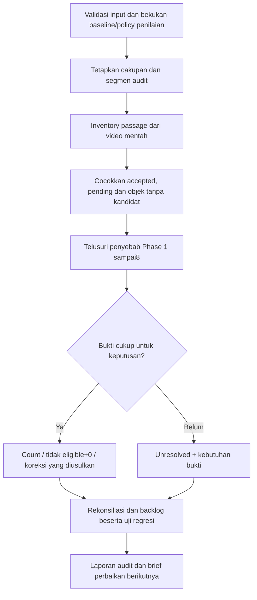

# Protokol Phase 9 — input, penelusuran masalah, dan output perbaikan

**REQUIREMENT:** menghasilkan daftar perbaikan Phase 1–8 berbasis bukti. Audit menguji hitungan palsu, duplikasi, salah gabung, passage terlewat, role, kategori, arah dan sumber crossing. Pending boleh selesai sebagai tidak eligible/+0. Dokumen ini merancang pekerjaan; tidak berisi hasil eksperimen baru.

Tugas dan kontrak terbaru: [PHASE_9_TASK.md](PHASE_9_TASK.md). Pelaksanaan: [prompt](PHASE_9_PROMPT.md). Pencatatan: [template](templates/PHASE_9_AUDIT_TEMPLATES.md).

[Hasil pilot aktual TGDI-WEEKDAY-SIANG](../results/phase_9/20261019T140653Z_TGDI_WEEKDAY_SIANG_PILOT/REPORT.md) merupakan paket bukti terpisah dari rancangan protokol ini. Pilot kasus terarah tidak menetapkan cakupan audit penuh.

## 1. Input yang diharapkan

| Input | Sumber yang tersedia / harus disediakan | Kegunaan dan pemeriksaan |
|---|---|---|
| Video asli atau klip native lengkap untuk segmen audit | Dataset Kaggle `/kaggle/input/datasets/chrisbiran/tgdi-traffic-videos`. | Inventory objek secara independen dari output model. Ikat filename, SHA-256 sumber, dimensi, rentang frame dan metode decode. MP4 anotasi saja tidak cukup untuk mencari semua kendaraan terlewat. |
| Metadata dan identitas delapan input | [Input preparation](evidence/phase_8/input_preparation/README.md), source identity pada batch report B v3. | Video yang benar, 640×480 untuk delapan TGDI ini, frame count dan FPS yang benar-benar tercatat. Nama toko/latitude/longitude tetap unknown. |
| Hasil counting B v3 | [Retensi final lokal](../results/b_v3/execution/final_20261019T045405_106031Z/retained_bytes_manifest.json). | Baca `batch_report.json.gz`; per video: `counting_result.json.gz`, `pending_groups.json.gz`, `person_role_review_queue.json.gz`, `geometry.json.gz`, `comparison_b_v2.json.gz`. Verifikasi hash byte asli setelah dekompresi sesuai manifest. |
| Anotasi dan manifest publikasi | [Daftar video B v3](../results/b_v3/VIDEOS.md), [delivery manifest](../results/b_v3/delivery_manifest.json). | Cocokkan versi, ukuran, checksum, source run dan frame. Label anotasi adalah keluaran mesin yang sedang diaudit. |
| Observasi model, jejak track, relasi komponen/duplicate | Cache donor yang dirujuk oleh source identity B v3; retensi dan manifest asal pada [bukti Phase 8](evidence/phase_8/README.md). | Telusuri bbox/class/raw ID/relasi per frame. Jika hanya emitted tracks tersedia, tidak bisa menyimpulkan bahwa detector sama sekali tidak membuat bbox. Raw detections diperlukan untuk diagnosis batas detector versus association. |
| Geometri efektif | [Manifest geometri B v2 yang dipakai B v3](../results/b_v2/config/geometry_manifest.json), serta `geometry.json.gz` tiap video. | Ikat hash, resolusi acuan/native, polygon A/B, finite line, half-margin 25px, transformasi serta arah. Jangan memakai kembali koordinat TOR3 sebagai native TGDI. |
| Policy, source dan review saat run | [Policy B v3](../results/b_v3/config/policy.json), [review manifest](../results/b_v3/input/review_decisions.json), source snapshot dalam retensi run. | Bedakan executed policy dari assessment policy terbaru. Catat commit/hash executable dan config; review-assisted dibedakan dari machine-only. |
| Review pengguna dan bukti kasus | [Role review](PHASE_9_ROLE_REVIEW_WORKFLOW.md), [paket bukti native](evidence/phase_9/role_review_20261019/evidence.json), keputusan pada tugas Phase 9. | Simpan sumber keputusan, interval inklusif dan parent vehicle. Review satu frame tidak otomatis berlaku sepanjang raw ID. |
| Rencana cakupan audit | Diisi pada `audit_plan.md` dan `segments.csv`. | Full-video atau sampling, interval, kondisi, tujuan pemilihan, split, siapa mereview dan riwayat paparan. Besaran sampling belum ditetapkan sebagai fakta. |

**Readiness per input:** `VERIFIED`, `AVAILABLE_UNVERIFIED`, `MISSING`, `INVALID`, atau `NOT_CHECKED`. Missing/invalid bukan data nol. Bukti gambar yang belum tersedia menghasilkan `NOT_REVIEWED`/`BLOCKED_EVIDENCE` pada kasus terkait; analisis struktur lain tetap bisa dilanjutkan. Jangan mengasumsikan file `/tmp` dari sesi sebelumnya masih tersedia.

Video asli tetap di Kaggle atau penyimpanan sumber. Di GitHub simpan dokumen, metadata, frame/klip bukti terpilih yang diperlukan, dan manifest; jangan menggandakan dataset asli.

## 2. Unit analisis dan definisi kesalahan

Unit utama adalah **passage fisik pada satu video**, dilengkapi episode kendaraan/orang. Berikan referensi manual yang tidak bergantung pada raw ID atau ID tampilan. Satu passage dapat cocok dengan nol, satu, atau beberapa event mesin; satu event salah gabung dapat terkait beberapa objek fisik.

| Istilah audit | Definisi kerja |
|---|---|
| Hitungan palsu | Event aktif tanpa passage fisik yang memenuhi aturan penilaian; misalnya kendaraan diam terkena timeout. Timeout tidak otomatis dianggap palsu hanya karena berstatus estimasi. |
| Duplikasi | Lebih dari satu event aktif untuk passage fisik yang sama, termasuk setelah pergantian ID. |
| Salah gabung | Observasi dari objek fisik berbeda disatukan, atau pedestrian dimasukkan sebagai rider tanpa bukti. Dapat menyebabkan hitungan palsu maupun passage terlewat. |
| Passage terlewat | Passage yang didukung inventory sumber tidak mempunyai representasi hitungan yang sesuai. Catat apakah tidak ada kandidat, pending, ditolak, atau digabung ke objek lain. |
| Tidak eligible/+0 | Keputusan berbukti bahwa kandidat tidak menambah hitungan: rider, duplikat passage yang sudah dihitung, kendaraan diam/tidak melintas, atau fragmen sesudah garis yang menjauh. Alasan tetap disimpan. |
| Unresolved | Bukti belum cukup untuk memutuskan; bukan sinonim +0 atau accepted. Dampak count tetap unknown. |

Keluarga kesalahan dapat overlap; jangan menjumlahkannya menjadi total objek unik. Ketidakjelasan peran tidak otomatis berarti passage terlewat. Role pedestrian positif juga tidak otomatis mengesahkan crossing.

## 3. Urutan penyelesaian audit



1. **Bekukan acuan.** Audit B v3 final run `20261019T045405_106031Z`; anotasi Kaggle version2/run `20261019T070846_020453Z`. Verifikasi executed policy, input dan source hash; catat keputusan timeout baru sebagai assessment policy terpisah. Jangan mengganti manifest lama agar cocok dengan aturan baru.
2. **Kalibrasi pencatatan melalui pilot development.** Gunakan TGDI-WEEKDAY-SIANG dengan kasus 54,166/185,857/856 dan3025@5003. Perluas konteks sebelum/sesudah sesuai bukti; jangan mengarang batas episode dari satu sampel. Pilot bukan bukti keberhasilan semua video.
3. **Tetapkan cakupan.** Target review mencakup delapan video, pagi/siang/sore/malam, weekday/weekend dan kondisi sulit. Full versus sampling dan interval dinyatakan sebelum klaim cakupan. Jika belum dipilih, siapkan inventaris dan usulan; minta keputusan hanya untuk cakupan yang memengaruhi pelaksanaan. Rekomendasi full-video adalah usulan, bukan pekerjaan yang sudah selesai.
4. **Inventory sumber lebih dahulu.** Catat objek fisik, gerak, passage/kemungkinan tidak melintas, role dan bukti dari video mentah sebelum membuka overlay untuk segmen baru. Pengguna sudah mereview delapan anotasi; sebut paparan tersebut dan jangan mengklaim blind audit.
5. **Pencocokan dua arah.** Dari inventory ke mesin untuk mencari miss; dari setiap event mesin dalam scope ke inventory untuk mencari hitungan palsu/duplikasi. Masukkan pending dan rejected/cancelled sebagai konteks, bukan hitungan tambahan.
6. **Telusuri akar masalah.** Bandingkan piksel → raw detection → assigned track → episode/relasi → anchor/geometry → event → panel/agregat. Pisahkan sebab teramati dari hipotesis. Bila raw detections tidak tersedia, tandai atribusi detector/association belum dapat ditentukan.
7. **Adjudikasi.** Catat keputusan dan alasan per interval. Konflik atau keputusan yang mengubah count memerlukan review manusia sebelum dipromosikan sebagai keputusan pengguna; AI-assisted tetap diberi label sumbernya. Jangan menjumlahkan suara agen sebagai bukti kebenaran.
8. **Susun backlog dan laporan.** Prioritaskan dampak fisik yang terverifikasi, risiko salah gabung, cakupan kondisi dan kebutuhan bukti. Volume pending boleh menjadi petunjuk beban review, bukan bukti frekuensi kesalahan fisik atau persentase manfaat.

Frame menggunakan indeks **0-based, batas inklusif**. Simpan rentang inti yang dinilai dan konteks yang hanya membantu review. Coverage dihitung sebagai union frame inti per video, bukan jumlah panjang klip overlap. Jika satu passage menyentuh dua segmen, gunakan referensi passage yang sama; jangan menghitung dua kali. Segmen yang memotong kejadian di batas tetap memerlukan konteks atau diberi unresolved.

Development dan validasi tidak boleh membelah episode/passage yang sama seolah independen. Catat ketergantungan tracker/episode offline yang memakai konteks di luar window. Segmen yang sudah dilihat atau dipakai menentukan aturan tidak disebut hold-out blind; jika tidak ada data yang belum dipakai, nyatakan keterbatasan itu.

## 4. Input → proses → output per fase yang diperbaiki

Ini adalah delapan **jalur diagnosis dalam Phase 9**, bukan perintah menjalankan ulang delapan fase. Output sekarang berupa temuan, keputusan dan spesifikasi uji. Implementasi serta eksperimen baru menunggu tugas perbaikan sesudah audit/brief pivot.

| Fase | Input audit | Proses diagnosis | Output yang diharapkan |
|---|---|---|---|
| **1 — Inspeksi** | Video native, metadata, frame indeks/timestamp yang tersedia, klip before/during/after. | Tandai gelap, silau, blur, occlusion, shake/alignment, tepi frame dan decode mismatch. Pastikan frame benar sebelum interpretasi model. | Register kondisi sulit per video/rentang; batas review; masalah decode/PTS jika ada dan kebutuhan bukti tambahan. |
| **2 — Deteksi** | Inventory sumber, raw detections dengan bbox/class/score dan config detector jika tersedia. | Periksa apakah kendaraan terlihat tetapi tidak dideteksi, bbox/BC tidak mewakili kendaraan, atau kelas salah. Bedakan dari bbox yang ada namun hilang di association/downstream. | Kasus detector terkonfirmasi atau atribusi unresolved; spesifikasi eksperimen terarah tanpa langsung memilih retraining. |
| **3 — Tracking** | Detections, emitted tracks, riwayat posisi/class, gap dan kandidat pesaing. | Telusuri fragmentation, ID switch, raw ID berpindah objek, serta dua kendaraan yang keliru disatukan. Verifikasi same/different physical object dalam interval. | Peta episode/alias terbatas beserta kontradiksi; daftar kasus sambung/pisah dan uji negatif dua kendaraan berdekatan. |
| **4 — ReID** | Kasus association terverifikasi; bukti off/on yang benar-benar tersedia, encoder/config/provenance. | Tentukan apakah penampilan membantu asosiasi atau salah menyambung kendaraan mirip. Tanpa pasangan bukti setara, hanya susun kebutuhan eksperimen. | Kartu eksperimen vehicle-ReID: tujuan, data, kontrol, uji regresi dan status `NOT_RUN`; final config tetap OPEN. ReID tetap arsitektur. |
| **5 — Geometri** | Geometri efektif per video, dimensi/transformasi, raw vehicle BC dan trajectory terukur. | Periksa polygon/line/margin, batas endpoint, alignment temporal, arah dan jitter. Bedakan terukur dengan perpindahan selama gap. | Keputusan kesesuaian per video/interval, kasus geometri invalid/ambigu, usulan revisi atau spesifikasi tes sintetis. Tidak hardcode koordinat baru. |
| **6 — Counting** | Episode/role/category yang direview, geometry evidence, event dan timer state yang tersedia. | Periksa satu unit/satu passage, rider+0, kategori pita, eligible timeout, last-origin clock, handoff, putar balik, passage selesai dan genuine return. | Keputusan per kandidat: count sesuai bukti, tidak eligible/+0, atau unresolved; daftar pelanggaran kontrak dan uji state machine. |
| **7 — Malam** | Segmen malam raw, kondisi sulit, hasil TOR3 raw/gamma historis, config terikat. | Audit error malam dan cocokkan pasangan raw/enhanced hanya bila bukti setara sudah ada. Bedakan gelap, silau, blur, missed vehicle dan kegagalan association. | Peta failure malam; spesifikasi perbandingan raw/kandidat pada passage sama, dengan kontrol counting beku, split dan biaya. Belum menetapkan filter produksi. |
| **8 — Output/agregasi** | MP4 B v3, event machine, overlay review, kategori/arah/route dan subtotal. | Cocokkan bbox/ID/raw-parent rider, BC, frame log dan panel terhadap event. Periksa pending tidak masuk subtotal, versi machine/reviewed tidak dijumlahkan, dan state antarklip/video tidak bocor. | Temuan keterbacaan/anotasi dan tabel rekonsiliasi; spesifikasi perubahan renderer terpisah dari perubahan counting. |

### Pemeriksaan penentu setiap jalur

- **Phase 1:** frame dari random seek yang tidak cocok dengan sumber cache bukan bukti untuk frame tersebut. Decode berurutan atau metode yang terverifikasi boleh digunakan; simpan source frame index dan pixel/hash yang tersedia. Tanpa PTS otoritatif, frame/FPS hanya perkiraan waktu; jangan menyimpulkan CFR/VFR atau dropped frames dari perbedaan metadata saja. Timeout tetap 60 frame sumber.
- **Phase 2:** cache TOR3 awal menyaring skor di bawah0,25. Replay cache itu tidak bisa menguji deteksi yang sudah dibuang. Catat config cache aktual setiap video; jangan mengasumsikan semua cache sama. Eksperimen confidence lebih rendah memerlukan data/inference baru dalam tugas terpisah.
- **Phase 3:** perubahan class saja belum membuktikan objek berganti. Bukti posisi, kontinuitas gerak, koeksistensi/pesaing dan piksel perlu diperiksa. Kasus166 tidak boleh diselesaikan dengan satu alias global.
- **Phase 4:** encoder person-domain yang sudah diuji belum dipilih sebagai default vehicle. ID lebih sedikit, lebih banyak embeddings atau cost berubah tidak membuktikan identitas membaik. Tidak ada model/weights/threshold baru yang dipilih oleh protokol ini.
- **Phase 5:** TGDI sekarang memakai geometri native 640×480; sumber TOR31280×720 atau template 960×540 mempunyai transformasi tersendiri. Margin dan koordinat harus menyebut unit/resolusi. Transfer template tetap perlu review, termasuk tepi finite segment; bbox union tidak mengganti raw BC vehicle.
- **Phase 6:** timer melekat pada episode/passage fisik yang didukung, bukan semata raw ID. Observasi origin dan handoff terverifikasi memperbarui clock yang sama. Konflik identitas relevan menahan estimasi. Passage selesai tidak dibuka oleh timeout; kendaraan baru terlihat di sisi tujuan dan menjauh memberi0 jika buktinya cukup. Kriteria numerik gerak/association masih OPEN. Positive role tidak otomatis +1; unknown bukan pedestrian. Genuine return yang benar tetap passage baru.
- **Phase 7:** raw tetap baseline penelitian. Gamma0,7 pada eksperimen TOR3 tidak menetapkan enhancement produksi atau manfaat otomatis umum. Pengalaman TGDI malam diproses tidak membuktikan filter reliable. Jangan menjalankan enhancement baru/tuning bersamaan dengan perubahan counting dalam tugas audit ini.
- **Phase 8:** raw ID perlu terbaca termasuk unknown/pending; ID passage dan parent vehicle tidak disamakan. Perubahan tampilan seharusnya tidak mengubah event; nanti verifikasi byte/hash/count ledger tetap sama untuk render-only. Jika label tumpang tindih, gunakan record sumber dan catat masalah tampilan, jangan menebak ID.

## 5. Keputusan kasus dan dampaknya

Pisahkan tiga sumbu agar pending tidak otomatis dipromosikan menjadi accepted:

| Sumbu | Nilai kerja yang diusulkan untuk pencatatan audit |
|---|---|
| Hasil review | `COUNT`, `NO_COUNT`, `UNRESOLVED`. |
| Jenis bukti passage | `MEASURED`, `INFERRED`, `UNKNOWN`; route asli tetap disimpan, bukan diganti oleh label review. |
| Tindak lanjut kasus (`case_action`) | `KEEP`, `PROPOSE_ADD`, `PROPOSE_CANCEL`, `PROPOSE_MERGE`, `PROPOSE_SPLIT`, `PROPOSE_RECLASSIFY`, `NEEDS_EVIDENCE`, `POLICY_OPEN`. |

Nilai di atas adalah **format audit**, bukan schema API produksi atau status baru yang sudah diimplementasikan. `case_action` adalah tindak lanjut keseluruhan kasus; `event_actions` pada template berisi usulan terhadap event tertentu. Untuk missed passage tanpa event mesin, `PROPOSE_ADD` menunjuk passage manual dan membiarkan baseline event IDs kosong; jangan membuat ID event mesin fiktif. Keputusan role, identitas dan passage dicatat terpisah. Simpan raw ID, interval, relation type, parent, event IDs dan sumber bukti. Jika perluasan interval merupakan asumsi, tandai secara eksplisit.

`NO_COUNT` pada rider berarti rider tidak menambah unit; motor terkait diperiksa sebagai passage sendiri. Duplikat bisa dibatalkan sementara passage fisiknya tetap berkontribusi 1 melalui event lain. `UNRESOLVED` tidak otomatis membuat koreksi−1 pada accepted lama: hasil machine tetap dibekukan, status reviewed dicatat belum final. Jangan menghapus ketidakpastian hanya agar tabel total dapat diisi.

Untuk rekonsiliasi, simpan **jumlah event aktif baseline yang cocok**, **kontribusi reviewed yang diputuskan**, dan **delta** pada level passage/kelompok kasus yang tidak overlap. Contoh aritmetika hipotetis: baseline 2 event untuk satu passage valid → reviewed 1 → delta−1; baseline 0 → reviewed passage valid 1 → delta+1; baseline 0 pending → keputusan tidak eligible 0 → delta0. Itu ilustrasi, bukan hasil audit. Jika keputusan belum pasti, reviewed contribution dan delta bernilai null, bukan0.

Jika satu event salah gabung terkait beberapa passage, gunakan `reconciliation_group_id` pada template: hitung event baseline unik dan passage reviewed unik pada kelompok, bukan menjumlahkan baris yang berbagi event. Keputusan yang belum dapat dialokasikan per passage tetap mempunyai delta kelompok atau null, tanpa alokasi fiktif.

Kategori/arah yang dikoreksi bisa menghasilkan perpindahan antar-sel subtotal tanpa mengubah total. Simpan kategori×arah×jenis bukti; pisahkan vehicle/pedestrian dan measured/inferred. Jangan menjumlahkan machine+reviewed. Jangan memaksakan total reviewed final selama bagian scope masih unresolved; laporkan bagian yang sudah diputuskan serta bagian belum final secara terpisah.

## 6. Output yang diharapkan

**PROPOSAL — struktur hasil ketika audit benar-benar dilaksanakan:**

```text
results/phase_9/<audit_id>/
  audit_plan.md
  input_manifest.json
  segments.csv
  passage_inventory.csv
  cases.jsonl
  review_decisions.jsonl
  improvement_backlog.csv
  comparison.csv
  REPORT.md
  evidence/
    manifest.json
    <frame-atau-klip-bukti-terpilih>
```

| Artefak | Isi minimum / tujuan |
|---|---|
| `audit_plan.md` | Tujuan, scope disepakati/proposed, baseline, assessment policy, split dan siapa melakukan review. |
| `input_manifest.json` | Source/run/version/hash, ketersediaan/verifikasi tiap input, executable/config saat run dan policy audit terbaru. |
| `segments.csv` | Rentang inti/konteks, kondisi, split, paparan reviewer, status review serta cakupan yang belum dilihat. |
| `passage_inventory.csv` | Objek/passage manual dari sumber, termasuk tidak melintas dan tanpa kandidat. Raw IDs/event IDs boleh kosong. |
| `cases.jsonl` | Masalah, sebab primer/faktor tambahan, evidence refs, hipotesis versus temuan, fase terdampak dan blocker. |
| `review_decisions.jsonl` | Keputusan terbatas interval, sumber reviewer, role/parent/identitas/passage, event terdampak dan riwayat supersession. |
| `improvement_backlog.csv` | Satu perbaikan per akar masalah: bukti kasus, prioritas beralasan, lingkup minimum, input yang diperlukan, proses perubahan yang diusulkan, output dan tes/regresi. |
| `comparison.csv` | Pencocokan baseline dengan hasil reviewed per passage. Revisi mesin yang belum dijalankan diberi `NOT_RUN` dan nilai kosong/null. |
| `REPORT.md` | Cakupan, temuan terkonfirmasi, hipotesis, decisions, no-count, unresolved, rekonsiliasi, backlog, risiko malam, next task dan gate Phase 10. |
| `evidence/manifest.json` | Identitas sumber dan derivasi setiap gambar/klip: frame range, hash, crop/resize jika ada, asal user/AI/machine dan case references. |

Nama di atas adalah artefak yang direncanakan, bukan laporan yang sudah dihasilkan. Template berada di [dokumen template](templates/PHASE_9_AUDIT_TEMPLATES.md). Jangan membuat baris contoh seolah pengukuran aktual; nilai belum diperiksa tetap kosong/null/unknown.

## 7. Prioritas backlog dan ukuran keberhasilan

**PROPOSAL — urutan awal, ditinjau berdasarkan audit aktual:**

1. Episode/identitas yang menciptakan hitungan palsu, duplikasi atau salah gabung; termasuk relasi terhadap clock timeout.
2. Rider/pedestrian dan sumber kategori/BC yang memengaruhi unit hitung.
3. Passage tanpa kandidat serta accepted estimasi yang tidak didukung passage fisik.
4. Geometri/decode/output yang menghalangi review atau mengubah keputusan.
5. Eksperimen malam dan vehicle-ReID yang kebutuhan datanya sudah jelas.

Kondisi nyata dapat mengubah urutan. Jangan menyebut ini ranking frekuensi error atau janji Pareto80/20. Setiap backlog item harus menunjuk case IDs, bukti, sebab, keputusan yang masih dibutuhkan, perbaikan minimum, input–proses–output, biaya yang diketahui/unknown dan uji regresi positif/negatif. Jika bukti sebab belum cukup, itemnya adalah pengumpulan bukti, bukan tuning berdasarkan tebakan.

Bandingkan passage fisik yang sama dan scope yang sama. Catat hitungan palsu, duplikasi, salah gabung, passage terlewat, salah role/kategori/arah, pending yang selesai sebagai count/no-count, unresolved, regresi serta biaya yang benar-benar diukur. Keluarga error overlap; gunakan unique case/passage IDs untuk rekap. Jumlah raw track/CSV rows bukan denominator kendaraan.

**Audit berhasil** bila daftar perbaikan dapat ditelusuri, keputusan dan batasnya jelas, serta tersedia spesifikasi pengujian. **Perbaikan otomatis berhasil** hanya setelah implementasi/eksperimen terpisah benar-benar menunjukkan pengurangan kesalahan pada data pembanding yang sesuai, dengan regresi ikut diperiksa. Pada tugas audit, hasil pembanding mesin baru tetap `NOT_RUN` jika tidak dieksekusi; perbaikan hasil reviewed tidak diklaim sebagai keberhasilan algoritme.

## 8. Gate penutupan Phase 9

- Input dan versi evidence terverifikasi atau keterbatasannya dicatat per kasus; frame invalid tidak digunakan sebagai bukti.
- Scope/coverage aktual jelas. Tidak mengklaim audit delapan video selesai bila hanya pilot/sampel ditinjau.
- Inventory sumber dicocokkan dua arah; accepted estimasi, pending dan objek tanpa kandidat tercakup sesuai rencana.
- Setiap kasus dalam scope memiliki count/no-count yang didukung atau unresolved dengan perlakuan, kebutuhan bukti dan dampak yang belum final.
- Rekonsiliasi tidak menggandakan event, passage overlap, machine/reviewed, atau kategori error yang overlap.
- Backlog Phase 1–8 memiliki bukti dan uji regresi. Eksperimen baru, termasuk malam, jelas statusnya belum dijalankan.
- Laporan menyebut keputusan OPEN, blocker, next task dan apakah perlu kembali memperbaiki prototype sebelum Phase 10.

Tidak ada target persentase, klaim zero error atau metrik accuracy/precision/recall/F1/MAPE/counting accuracy. Ikuti [EVALUATION.md](EVALUATION.md). Penutupan audit pada cakupan yang disepakati tidak berarti seluruh perbaikan selesai atau sistem siap produksi.
