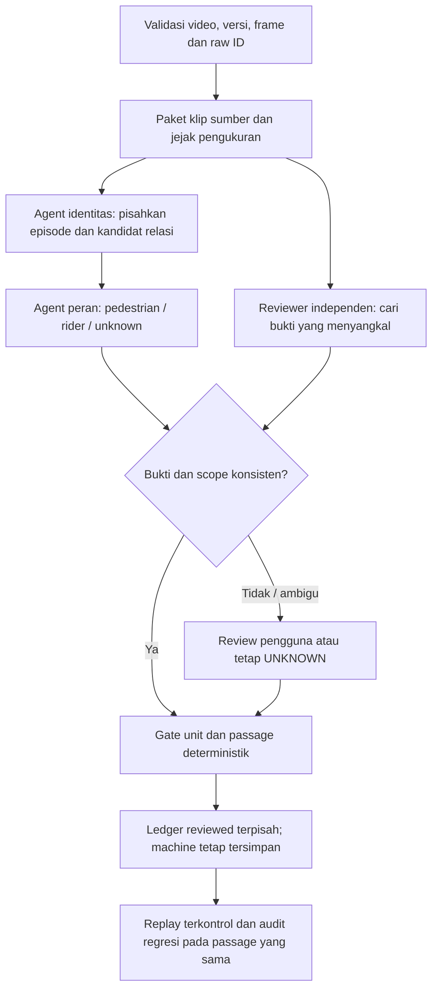

# Phase 9 — workflow audit pedestrian/rider

**Status: rancangan workflow dan audit bukti, bukan implementasi.** Pengguna menahan coding sambil menyelesaikan Phase 9 dan akan memberi brief pivot sesudahnya. Tidak ada source aplikasi, konfigurasi, atau ledger counting yang diubah. Tidak ada detector, tracker, ReID, atau counting yang dijalankan ulang untuk analisis ini.

## Keputusan pengguna dan bukti yang diperiksa

Pengguna mereview anotasi **V2** TGDI-WEEKDAY-SIANG. Pemeriksaan memakai pengukuran asal yang tersimpan dan ledger **B v3** untuk sumber video yang sama: 640×480, 9.128 frame, indeks 0–9.127. Raw ID tetap dibedakan dari ID tampilan passage.

[Paket bukti aktual](evidence/phase_9/role_review_20261019/evidence.json) menyimpan source hashes, sebelas PNG native dengan pixel SHA yang cocok dengan input detector tersimpan, enam relasi terkait, event asli, dan keputusan pengguna yang dibatasi frame. Gambar diperoleh melalui decode berurutan; hasil random seek yang pikselnya tidak cocok dikeluarkan. Review visual ini mencakup sampel frame, bukan seluruh frame setiap interval.

| Kasus | Review pengguna | Temuan aktual | Perlakuan audit |
|---|---|---|---|
| Person54, frame57–107 | Pedagang gerobak adalah PEDESTRIAN saja. | Frame57/82/107 menunjukkan orang berjalan mendorong gerobak. B v3 masih unknown-person. | Catat role pedestrian dalam scope review. Gerobak tidak menambah motorcycle. Validitas passage +1 diperiksa terpisah. |
| Person166 → motorcycle185, frame226 | RIDER; rider +0, satu unit motorcycle. | Keduanya terdeteksi sebagai person/motorcycle. Relasi component215–292 ditolak karena maksimum residual gerak relatif sekitar0,18585 melebihi kontrol eksperimen0,15, walaupun ada78 frame bersama berurutan. | Periksa relasi fisik dan kontinuitas episode; jangan sekadar menaikkan threshold global. |
| Person857 → motorcycle856, frame1089 | RIDER; rider +0, satu unit motorcycle. | Relasi1082–1097 ditolak karena residual sekitar0,17950 melebihi0,15; interval1100–1113 didukung; interval1119–1143 ditolak karena fraksi BC-inside0,68 di bawah kontrol1,0. | Hubungan lokal berganti supported/unknown. Role pada frame review tidak otomatis berlaku bagi seluruh riwayat857. |
| Person3025, frame5003 | PEDESTRIAN; pengguna mengoreksi50003 menjadi5003. | Frame5003 yang terverifikasi menunjukkan orang berjalan. B v3 masih unknown-person. | Catat role pada frame5003. Tidak menganggap frame50003 pernah ada atau otomatis menerapkan role pada seluruh track. |

Angka gate di atas adalah **nilai eksperimen tersimpan**, bukan rekomendasi threshold baru atau nilai yang sudah tervalidasi. Tidak ada tuning pada analisis ini. Ketiadaan relasi rider yang didukung bukan bukti positif pedestrian.

## Temuan kritis: riwayat166 mencampur objek

Pada awal188–213, pengukuran motorcycle166 berada pada motor nyaris diam di tepi kanan. Pada215–292, ID166 menjadi person pada pengendara motor185. Pada296 dan sebagian frame akhir, ID itu kembali berlabel motorcycle. [Frame188](evidence/phase_9/role_review_20261019/frame-188.png), [226](evidence/phase_9/role_review_20261019/frame-226.png), dan [296](evidence/phase_9/role_review_20261019/frame-296.png) menyediakan bukti sampel untuk pemeriksaan identitas tersebut.

Ledger B v3 yang belum dikoreksi mempunyai:

- Motorcycle185, `M1006`: `LINE_MARGIN`, B→A, keputusan251.
- Track166, `M1007`: `OCCLUSION_DIFF_POLYGON`, B→A, aktivasi273/keputusan296, dengan riwayat motorcycle awal188 dan akhir296.

Ini adalah prioritas audit event tambahan dengan riwayat identitas yang tercampur. Rekomendasi review: pisahkan episode/objek sebelum menentukan apakah event166 harus dibatalkan; jangan menerapkan rider global pada semua penggunaan ID166. Perubahan kelas saja juga tidak selalu membuktikan objek berganti: kontinuitas fisik perlu diperiksa.

Untuk856/857, ledger hanya memuat satu event kendaraan856, `M1021`, melalui timeout pada1203. Gagal menghubungkan rider tidak selalu berarti sudah terjadi double counting. Keputusan role tidak mengubah timeout menjadi crossing terukur.

## Keterbacaan ID untuk review

[Reproduksi lokal frame226 dari renderer yang sudah ada](evidence/phase_9/role_review_20261019/current-v3-frame-226-local-render.png) memperlihatkan raw IDs tersedia pada teks, tetapi label bertumpuk dan sebagian teks tertutup. Ini bukan klaim bahwa semua ID hilang, dan PNG tersebut bukan frame yang diekstrak langsung dari MP4 rilis. Versi OpenCV dan sumber reproduksi tercatat pada paket bukti.

**PROPOSAL untuk perubahan berikut, belum diterapkan:** raw ID harus menjadi token awal yang pendek dan terbaca pada semua unit, termasuk unknown/pending. ID passage tetap terpisah dan hanya tampil ketika dialokasikan. Untuk unit gabungan, label/panel mempertahankan pemetaan motorcycle raw185 ↔ rider raw166 tanpa memberikan hitungan kedua. Ukuran huruf, penempatan, pemisahan baris dan tabrakan label diuji pada hasil render aktual; perubahan tampilan tidak mengubah counting.

Contoh teks yang diusulkan: `raw54 | person | UNKNOWN`; `raw166 | RIDER → raw185`; `M1006 | motorcycle | raw185 + rider166`. Ini contoh format tampilan, bukan alokasi ID/event baru.

## Tiga sumber kegagalan prioritas

Ketiganya adalah prioritas analisis berdasarkan kasus ini, **bukan ranking frekuensi atau persentase kegagalan terukur**.

1. **Batas taxonomy detector.** Model yang dipakai menghasilkan kelas person; label itu tidak secara langsung memuat peran pedestrian/rider. Mendeteksi rider sebagai person belum tentu kesalahan deteksi.
2. **Asosiasi orang–motor yang rapuh.** Overlap, kedekatan dan satu residual maksimum tidak cukup menjelaskan hubungan fisik sepanjang kejadian. Kasus166/185 dan857/856 memperlihatkan relasi ditolak atau berganti status pada orang–motor yang direview sama.
3. **Kontinuitas identitas/episode yang salah.** Satu raw ID dapat berganti objek dan kelas; asal dan tujuan dari objek berbeda tidak boleh digabung menjadi passage. Kasus166 merupakan contoh prioritas. Melabeli seluruh raw ID sebagai rider atau pedestrian dapat memperburuk kesalahan ini.

Gelap, silau, blur dan occlusion adalah faktor yang perlu diuji pada data yang benar-benar tersedia. Empat masukan siang ini tidak membuktikan frekuensi kegagalan pada malam.

## Workflow agentic yang diusulkan

Panah review pengguna menuju gate tidak berarti keputusan manual selalu meloloskan event. Unknown tetap di luar accepted; semua syarat counting tetap berlaku.

| Tahap | Tanggung jawab dan keluaran | Batas yang harus dipertahankan |
|---|---|---|
| Validasi bukti | Ikat video/source hash, versi anotasi, raw ID, indeks frame dan episode. | Frame yang tidak ada ditanyakan; tidak ditebak. Snapshot machine tidak ditimpa. |
| Paket bukti | Klip sebelum–selama–sesudah kejadian, frame penuh/crop, observasi sumber serta relasi yang ditolak/didukung. | Piksel/frame harus cocok dengan cache. Tidak membuat observasi pada interval hilang. |
| Agent identitas | Usulkan episode fisik dan hubungan person–motor dengan source references serta kontradiksi. | Jangan menganggap raw ID tetap berarti objek tetap; jangan menggabungkan seluruh sejarah dari satu contoh. |
| Agent peran | Usulkan PEDESTRIAN, RIDER/PASSENGER, atau UNKNOWN; parent vehicle, scope frame, dan alasan. | Penumpang termasuk komponen rider. Helm, overlap, co-motion atau ketiadaan motor saja tidak menjadi bukti tunggal. Pedagang gerobak mengikuti keputusan pengguna. |
| Reviewer independen | Menilai sumber sebelum membaca putusan pertama, lalu mencari salah gabung atau bukti role berbeda. | Uji pedestrian di samping motor, rider berhenti, motor tertutup, naik/turun, gerobak dan malam. Kesepakatan agen bukan ground truth. |
| Gate deterministik | Periksa bukti, policy, satu unit/satu passage, kategori, identitas dan geometri. | Rider +0; pedestrian memakai BC person sendiri; kendaraan memakai BC vehicle mentah. Bbox union hanya tampilan. Role positif tidak otomatis +1. |
| Review dan evaluasi | Simpan perbedaan baseline/usulan per passage fisik; human review pada konflik. | Tidak ada voting agen yang otomatis mengubah ledger accepted. Unknown atau disagreement tetap mempunyai status dan alasan. |

Semua usulan agen harus menyebut frame dan pengukuran sumber. Output tanpa sumber yang valid ditolak oleh gate; agen tidak boleh mengarang kelas, ID, motion, appearance embedding atau bukti crossing. ReID tetap pada arsitektur yang disepakati; ia bukan label pedestrian/rider. Pilihan model role baru, fine-tuning, pose model atau parameter baru belum dibuat dan menunggu brief pivot serta bukti audit.

## Cara menilai kontribusi workflow

Empat review ini menjadi bahan development. Bekukan aturan sebelum memeriksa segmen evaluasi yang belum dipakai menentukan aturan; jangan memecah track yang sama menjadi development dan hold-out seolah independen. Sebutkan cakupan dan keterbatasannya, tanpa klaim blind benchmark jika sumber sudah pernah dilihat.

Bandingkan passage fisik yang sama: salah role, rider yang dihitung sendiri, pedestrian yang terhapus karena salah digabung, motorcycle yang terduplikasi, event dari riwayat objek campuran, passage terlewat, pending serta beban review. Penurunan pending saja bukan bukti perbaikan. Uji juga accepted yang keliru dan kendaraan tanpa kandidat melalui inventaris manual video sumber.

Gunakan raw sebagai baseline. Uji malam dan enhancement memerlukan sumber/passage serta konfigurasi kontrol yang sama dan pencatatan regresi; eksperimen TOR3-MALAM terdahulu tidak menetapkan filter malam produksi. Tidak ada eksperimen malam baru dilakukan di sini.

Workflow ini belum dijalankan sebagai sistem role otomatis. Hasil model/counting belum diperbarui oleh empat review tersebut. Persetujuan role, keputusan validitas passage, dan promosi konfigurasi merupakan keputusan terpisah. Phase 9 belum dinyatakan selesai; implementasi berikutnya menunggu brief pivot pengguna.
